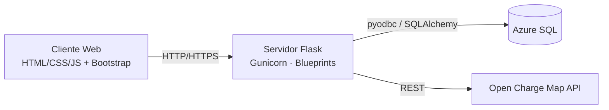
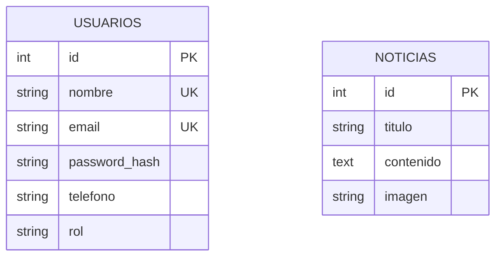
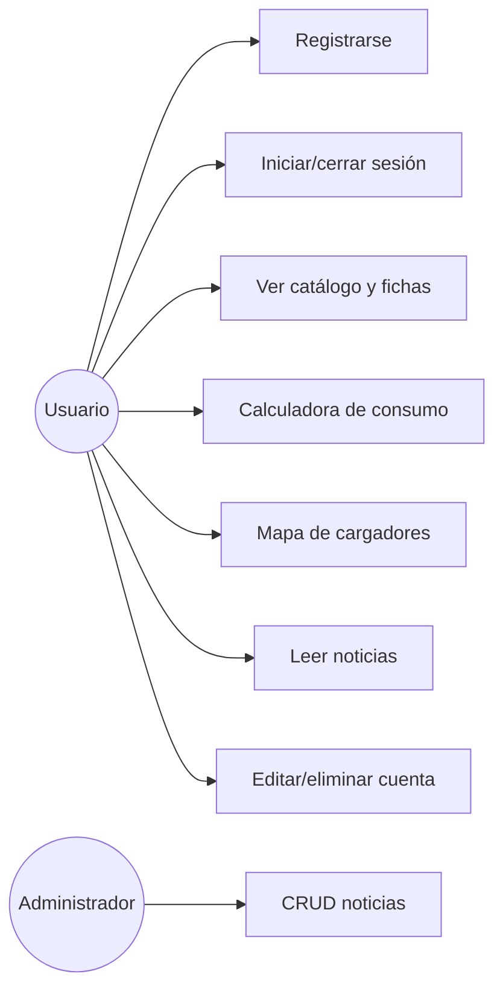
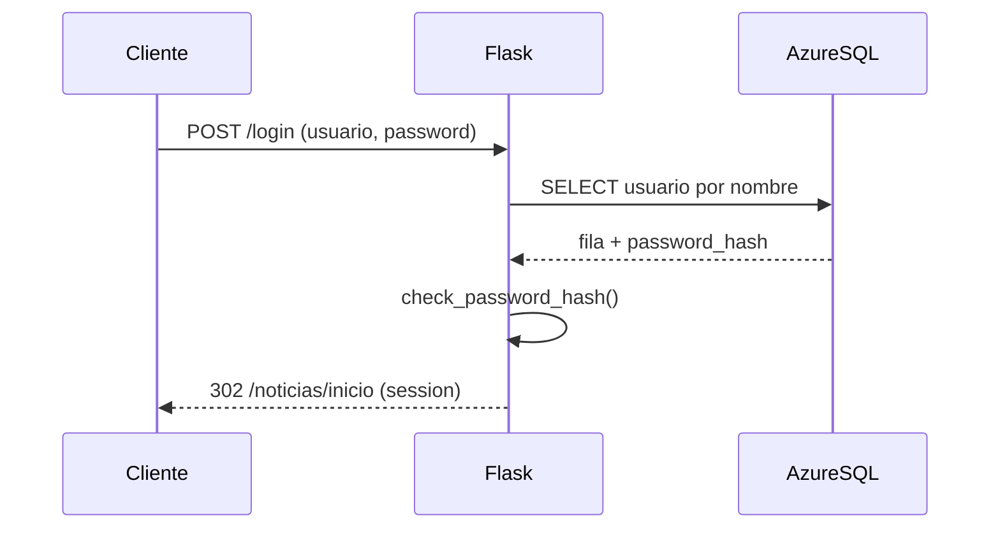

# Diagramas (Mermaid – se renderizan en GitHub)

## Despliegue

## Entidad–relación (implementado)

*Pendiente (extensión): VEHICULOS, VENTAS, TOKENS_RECUPERACION.*

## Casos de uso

## Secuencia – login

